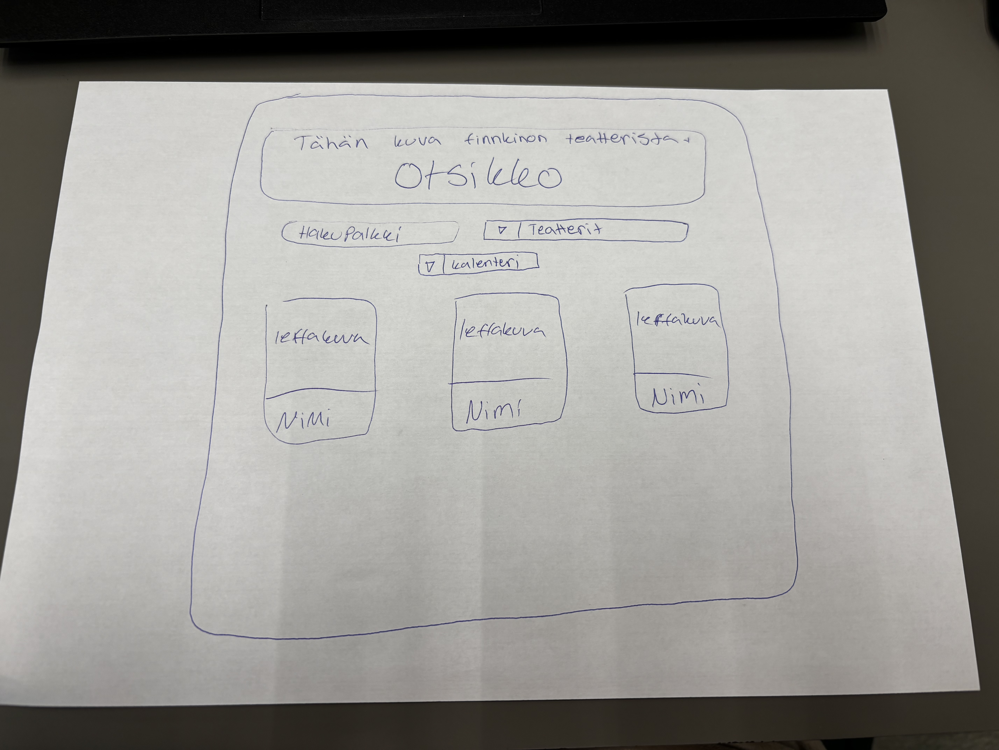
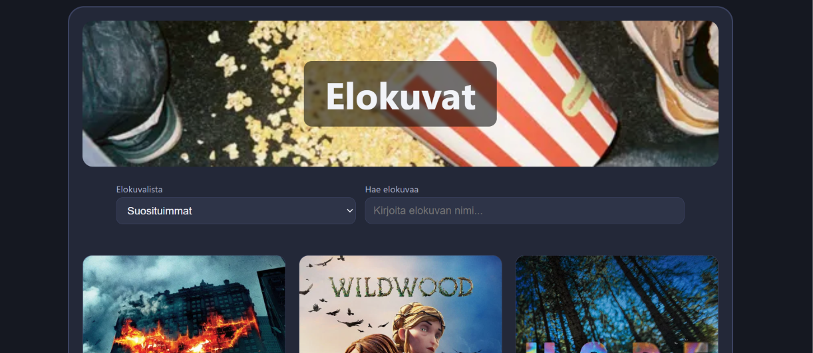

# Projekti_2_Milli
Projekti 2
# ELokuvien haku sovellus

**Tekijä(t):** Milli Haverinen

## Projektisuunnitelma
Suunnitelmana oli tehdä FInnkinon elokuvista sovellus mistä voi hakea Finnkinon elokuvia. Hakuna olisi teatteri, elokuva ja päivämäärä, että voi valita kalenterista ajan. Sivulla näkyisi suositeltuja elokuvia kuvakortteina.

### Projektin idea

Sovelluksella pystyy hakea elokuvia TMDB Apia käyttäen sieltä sivulta. Sovelluksellani voi hakea elokuvia nimen mukaan tai sitten suositeltuja elokuvia suodattimen mukaan. Sovellus sitten ohjaa TMDB sivulle ja seiltä näkee mistä elokuvan voi nähdä, esim jokin tietty suoratoistopalvelu.

### Suunnitellut toiminnot

Listaa vähintään kolme sovellukseesi suunniteltua toimintoa:

- Hae ja selaa elokuvia
- ELokuvat korteissa ja linkki elokuvan sivulle
- Suodata elokuvia esim. suosituimmat elokuvat
- Responsiivinen koneella ja puhelimella

### Rautalankamalli / luonnos

Piirsin rautalankamallin sen mukaan miltä finnkinon sovellus olisi näyttänyt, mutta muuten sain samanlaisen tähän, mutta en tuota kalenteria. 
Suunnittelin ulkönäön samanlaiseksi kuin todolistani näytti niin oli helpompi käyttä vähän samoja elemnttejä.

Esimerkki kuvan lisäämisestä:

## Verkkolinkit

- **Julkaistu sovellus:** [https://millimalau.github.io/Projekti_2_Milli/]
- **GitHub-repositorio:** [https://github.com/Millimalau/Projekti_2_Milli.git]
- **Projektin videoesittely:** [https://www.loom.com/share/508814c5c8d74a97884ff2dd9d82ce6c]

## Tietoja sovelluksesta

**[Elokuva sovellus]** on verkkosovellus, jolla pystyy hakemaan elokuvia mitä voisi katsoa. Sovelluksesta voi saada ideaa mitä katsoa seuraavaksi. 
Sovelluksella pystyy myös hyvin selvittämään mistä kyseisen elokuvan näkee, kun nykyää on niin paljon erilaisia suoratoistopalveluita.

Kuvaile lyhyesti sovelluksen tarkoitus ja tärkeimmät toiminnot.

## Teknologiat

Kuvaile, mitä teknologioita käytit ja mikä niiden rooli oli projektissasi.

- HTML – sivun rakenne
- CSS – ulkoasu ja asettelu
- JavaScript – fetch ja async/await datan hakuun
DOM-käsittely: kortit luodaan JavaScriptillä, ja tapahtumankäsittelijät lisätään dynaamisesti addEventListenerilla

## Sovelluksen käyttö

Kirjoita lyhyet käyttöohjeet sovellukselle.

1. Avaa julkaistu sovellus yllä olevasta linkistä.
2. Hae elokuvaa nimellä tai selaa elokuvia suodattimien mukaan
3. klikkaa elokuvaa nähdäksesi lisää tietoja elokuvasta ja mistä sen voi katsoa

## Sovelluksen käynnistäminen paikallisesti

API-avainta ei ole viety GitHubiin, joten se pitää lisätä itse:

Luo ilmainen tili osoitteessa https://www.themoviedb.org ja hae API-avain (Settings → API).
Kopioi tiedosto config.example.js nimellä config.js.
Avaa config.js ja korvaa teksti TÄHÄN_OMA_TMDB_API_AVAIN omalla API-avaimellasi.
Avaa index.html selaimessa (esimerkiksi VS Coden Live Serverillä).

Tiedosto config.js on lisätty .gitignore-tiedostoon, jotta avain ei päädy julkiseen repositorioon.

## Kuvakaappaukset

Lisää tähän vähintään yksi kuvakaappaus toimivasta sovelluksestasi.

Esimerkki kuvan lisäämisestä:

## Tunnetut virheet / puutteet

Kerro, jos sovelluksessa on tunnettuja virheitä, puuttuvia toimintoja tai muita rajoituksia.

Jos tunnettuja virheitä ei ole, kirjoita: **Ei tunnettuja virheitä.**

## Oma arvio ja oppimisen reflektointi

Pohdi työtäsi ja oppimisprosessiasi.

- omalta kkohdalta onnistuminen oli se, että sain toimimaan ton sovelluksen. Meinasin alkuun palauttaa sen finnkinon version, joka ei olisi toiminut.
- Haastavinta oli saada sovellus toimimaan oikein, että se hakee oikeasti ne tiedot. SIihen meni eniten aikaa.
- Parantaisin sovelluksessa ulkoasua ja lisäisin toimintoja.
- Haluaisin vielä enemmän oppia näistä rajapintojen käytöstä, että mitä kaikkia mahollisuuksia näissä voisi olla sovelluksia thedessä.
- Oma arvio projektista: **7/10 pistettä**

## Lähteet ja kiitokset

Listaa kaikki projektissa käyttämäsi lähteet, tutoriaalit, kuvat ja koodiesimerkit.

Jos käytit ChatGPT:tä, GitHub Copilotia tai muuta tekoälytyökalua, mainitse se tässä ja kerro lyhyesti, miten se tuki työskentelyäsi.

- [Lähteen tai tutoriaalin nimi](developer.mozilla.org) Tuolta tuli luettua vähän fetch ja DOM käyttöä.
- TMDB-rajapinta ja dokumentaatio: https://developer.themoviedb.org
- [Kuvalähde](https://unsplash.com/s/photos/movie) popcorn kuva palkissa. Kuvan julkaisija: Andrii Solok
- Käytetty tekoälytyökalu: Claude
  - Miten työkalua käytettiin: Käytin claudea koodien rakentamiseen, ja eniten siinä, kun en saanut finnkinon APIA toimimaan, niin jouduin tosi paljon kyselemään ratkaisuja. Claude sitten ehdotti, että käytän mielummin tätä TMDB, kun Finnkinon oli bvanhentunut eikä sitä löytynyt enää. 

  ## Lisenssi

Tämä projekti on lisensoitu MIT-lisenssillä.

Lisätietoa lisenssin lisäämisestä GitHub-projektiin:
https://docs.github.com/en/communities/setting-up-your-project-for-healthy-contributions/adding-a-license-to-a-repository